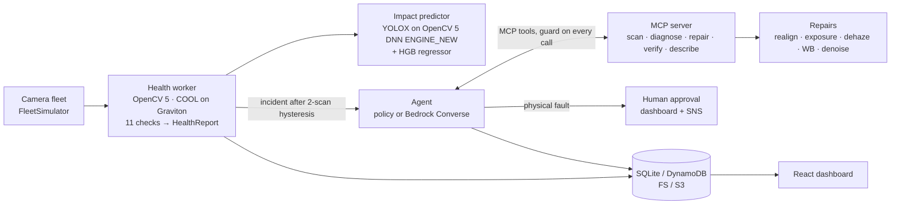

<p align="center">
  
</p>

<p align="center">
  
  
  
  
  
</p>

<p align="center">
  <!-- TODO: replace REPLACE_ME with the YouTube video id of the final demo -->
  <b>▶ <a href="https://youtu.be/REPLACE_ME">Watch the 5-minute demo</a></b>
  &nbsp;·&nbsp;
  <b>🌐 Live: <a href="https://djekr86y464c8.cloudfront.net">djekr86y464c8.cloudfront.net</a></b>
  &nbsp;·&nbsp;
  <a href="docs/REPORT.md">Technical report</a>
  &nbsp;·&nbsp;
  <a href="results/final/summary.md">Measured results</a>
</p>

---

## The problem

Cameras drift, fog up, get smudged, blinded and frozen, and nobody notices.
The detector downstream keeps running and silently gets worse.
Every camera AI is only as trustworthy as the camera feeding it.

**VisionDoctor** monitors a fleet of cameras with **OpenCV 5**, diagnoses 11 kinds of camera faults
(drift, defocus, dirty lens, haze, glare, occlusion, colour cast, noise, freeze, exposure,
vibration), **predicts how much downstream detector accuracy has been lost without labels**,
repairs software-fixable faults, **verifies every repair by re-scanning**, and escalates physical
faults to a human with face-blurred evidence. An agent (deterministic policy, or Amazon Bedrock
Converse with tool use) acts only through an **MCP tool server**, behind a guard, and every
decision is traced.

<p align="center">
  
</p>

Entry for the OpenCV AI Competition 2026 (powered by AWS): Grand Prize, Agentic Vision Award,
Best Use of COOL Award. Full specification in [`docs/`](docs/).

## How it works

### 1 · Scan: 11 OpenCV 5 checks against a learned reference

Each camera learns a reference (day/night buckets, static-region ORB anchors). Here the camera was
knocked five degrees: ORB features and a USAC MAGSAC homography measure the drift exactly.

<p align="center"></p>

The other checks catch haze, glare, smudges, occlusion, noise, colour casts, blur, exposure and
frozen streams. On real MOT17 street footage recall at severity ≥ 3 is **0.911** vs 0.239 for a
classic tamper detector.

<p align="center"></p>

### 2 · Predict: how much accuracy did the camera AI lose, with no labels?

YOLOX-S runs on the OpenCV 5 **new DNN engine**. In simulation every degraded frame has an identical
clean twin; how well the detector agrees with itself across the twins is the training target, and a
`HistGradientBoostingRegressor` learns to predict that loss from the health signals alone
(validated against **true** MOT17 AP drop: Spearman ρ **0.50**).

<p align="center"></p>

### 3 · Repair + 4 · Verify: a fix only counts if a fresh scan confirms it

Realign, exposure, dehaze, white balance, denoise, each with bounds. For drift, realignment
restored **92%** of the lost person-detection accuracy (AP 0.114 → **0.346**, clean 0.338).

<p align="center"></p>

### The guard: the agent can be wrong, the system cannot

The agent calls OpenCV only through 13 typed MCP tools, and a guard checks every call (allowlist,
bounds, scope, budgets, approvals). In a live Bedrock run the model passed the wrong repair id; the
guard blocked it, the agent re-planned, verified the fix, and only then closed the incident.

<p align="center"></p>

### 5 · Escalate: physical faults go to a human, with evidence

Anything software cannot fix (or any physical action) waits for one-click human approval, with
face-mosaicked evidence and the full agent trace.

| Incident queue (one-click approve) | Agent trace (OpenCV results change the plan) |
|---|---|
|  |  |

## Architecture

<p align="center"></p>

<p align="center"></p>



## The dashboard (live on AWS)

<p align="center"></p>

| Landing | Fleet |
|---|---|
|  |  |
| **Camera detail** | **Agent trace** |
|  |  |

## Measured results (all from `results/final/`)

| Experiment | Result |
|---|---|
| E1 fault detection, recall at severity ≥ 3 | **0.911** vs 0.239 classic tamper baseline; 0 alarms on clean bursts |
| E3 label-free impact vs **true** MOT17 AP drop | Spearman ρ **0.50** (95% CI 0.42–0.58); vs agreement target ρ 0.53 |
| E4 verified realign, person AP on MOT17 labels | 0.114 → **0.346** (clean 0.338): **92%** of lost accuracy recovered |
| E5 policy agent, 40 generated incidents | **75%** correct outcome, **65%** fewer operator alerts, 7/7 transients closed silently |
| Benchmark, 12 × 1080p cameras, stock OpenCV 5 | **Graviton4 c8g.large (2 vCPU): 119 scans/min**, p50 485 ms, **$7.55 per 1M scans** (on-demand, Mumbai, Price List API); laptop x86 16 threads: 101 scans/min |
| Live on AWS (Mumbai) | https://djekr86y464c8.cloudfront.net — Cognito login, Graviton4, Bedrock Nova Lite agent with guard |
| `cdk synth` + cdk-nag AwsSolutions | 8 stacks, 0 unsuppressed findings |

Failure cases and limits are reported in [`docs/REPORT.md`](docs/REPORT.md) §9.

## What is in the box

| Area | Where | Highlights |
|---|---|---|
| Health engine | `src/visiondoctor/health/` | Reference learning (day/night buckets, static-region ORB anchors), 11 checks, drift-compensated tile analysis, heat map |
| Repairs | `src/visiondoctor/repair/` | `warpPerspective` realign, gain/gamma LUT + CLAHE, dark-channel dehaze with box-filter guided filter, white balance, NL-means; bounds + verify with regression detection |
| Impact | `src/visiondoctor/impact/` | YOLOX-S on the OpenCV 5 **new DNN engine**, label-free agreement F1 target, `HistGradientBoostingRegressor` + 90% quantile interval, validated against **real MOT17 labels** |
| Agent + MCP | `src/visiondoctor/mcp_server/`, `agent/` | 13 typed MCP tools (SDK v2, stdio + streamable HTTP), guard (allowlist, bounds, scope, budgets, approvals), policy + Bedrock agents, traces |
| Privacy | `privacy/face_blur.py`, `vlm/describe.py` | YuNet face mosaic on every evidence image (fails closed); PaliGemma2 VLM path with rule-based fallback |
| API / UI | `api/`, `web/` | FastAPI (Cognito JWT), React + Vite + Tailwind + Recharts dashboard: fleet grid, camera detail with before/after slider, incident queue with one-click approve, trace viewer |
| Cloud | `infra/` | CDK v2 (Python): VPC, S3/DynamoDB/SQS, Cognito, **COOL Graviton ASG**, Fargate ARM64 API, CloudFront, CloudWatch dashboard/alarms/budget, benchmark stack; cdk-nag |
| Evidence | `eval/`, `bench/`, `results/` | E1–E5 experiments with bootstrap CIs, calibration, COOL benchmark harness |

## Quick start (local, no AWS account needed)

Requires Python 3.12, `uv`, Node 22, ~3 GB disk.

```bash
make setup          # venv + pinned deps (requirements.lock, hashes) incl. opencv-python-headless==5.0.0.93
make models data    # YOLOX + YuNet ONNX (OpenCV zoo), MOT17 videos + labels, OpenCV vtest
make test           # pytest: 77 tests — health, repairs, impact, privacy, golden agent traces, API
                    # (agent tests use a real-time simulator clock; on a heavily loaded machine one can flake)
make web            # build the dashboard into web/dist
make demo           # API + monitor + dashboard on http://localhost:8000
```

Then open http://localhost:8000 → **Demo** tab → start `demo` scenario (or `make demo-sim` for a
headless 12-camera run that writes frames + ground truth to `results/sim/`).

`python -m visiondoctor.cv_runtime` prints the OpenCV version, `cv2` path and whether COOL is active
(OpenCV < 5 aborts at import).

### Use the tools from Claude Code / any MCP client

```bash
claude mcp add visiondoctor -- .venv/bin/python -m visiondoctor.mcp_server.server --transport stdio
```

### Agents

`VD_AGENT=policy` (default, deterministic) or `VD_AGENT=bedrock` (Converse API; model from
`VD_BEDROCK_MODEL_ID`, SSM `/visiondoctor/bedrock_model_id`, or the newest active Claude Sonnet
inference profile). If Bedrock is unavailable the runner falls back to the policy agent and marks
the trace.

## Reproduce the evaluation

```bash
make eval-impact    # builds results/impact/dataset.csv (~40 min, 3 workers) and trains/validates the impact model
make calibrate eval # E1 detection, E2 false alarms, E4 repairs, E5 agent, results/summary.md
make bench figs     # OpenCV micro + end-to-end benchmark for this host, report figures
```

Seeds are fixed (7). Frozen outputs used by the report are copied to `results/final/`.

## Live deployment

**https://djekr86y464c8.cloudfront.net** (Cognito sign-in; judge credentials are in the private submission notes).


It is the credit-friendly *lean* profile (`infra/stacks/lean_stack.py`, ~$1.3/day): one Graviton4 `c8g.large`
(Ubuntu 24.04 + official OpenCV 5.0 wheel) behind CloudFront (origin reachable only from CloudFront's prefix list),
S3 + DynamoDB, Cognito, SNS alerts, CloudWatch metrics and dashboard, AWS Budgets alerts. The agent runs on Amazon
Bedrock (Nova Lite, Converse tool use) through the same guard as the policy agent. Deploy/destroy:
`python scripts/deploy_lean.py --email you@example.com` / `--destroy` (no CDK bootstrap needed).

## Deploy the full architecture (optional)

1. Subscribe to **Cloud Optimized OpenCV for AWS Graviton4 (COOL 3.1)** in AWS Marketplace, note the AMI id.
2. `cd infra && uv venv -p 3.12 .venv && uv pip install -r requirements.txt`
3. `make synth COOL_AMI_ID=ami-...` then `make deploy COOL_AMI_ID=ami-...`
4. Create the judge user in Cognito (group `operator`). `make down` destroys everything —
   **also cancel the Marketplace trial** (it converts to paid after 7 days).

On COOL hosts VisionDoctor is installed **without** the `opencv` extra so COOL's `cv2` under
`/opt/cool` is used; workers log `is_cool` at start and the benchmark saves `getBuildInformation()`.

## Responsible use

No face recognition anywhere; faces on evidence images are mosaicked before storage; frames
expire after 7 days and evidence after 90; any physical action (technician dispatch, PTZ move)
requires human approval; every agent decision is traced with the OpenCV numbers behind it.
VisionDoctor is reliability tooling for existing cameras, not a surveillance expansion.

## License

MIT (see `LICENSE`). Datasets and models keep their own licenses (`docs/DATA_LICENSES.md`).
