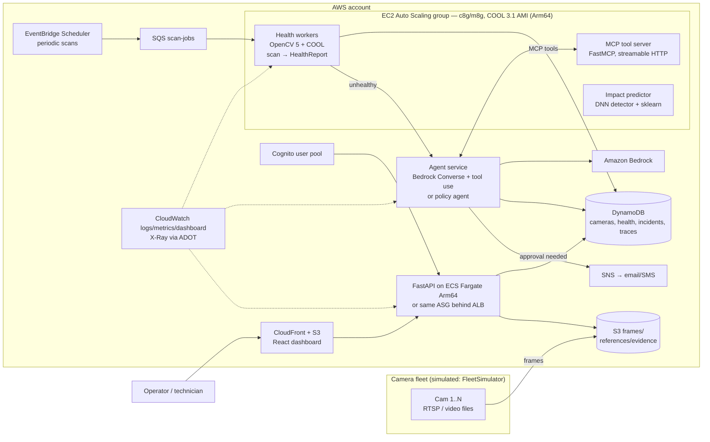
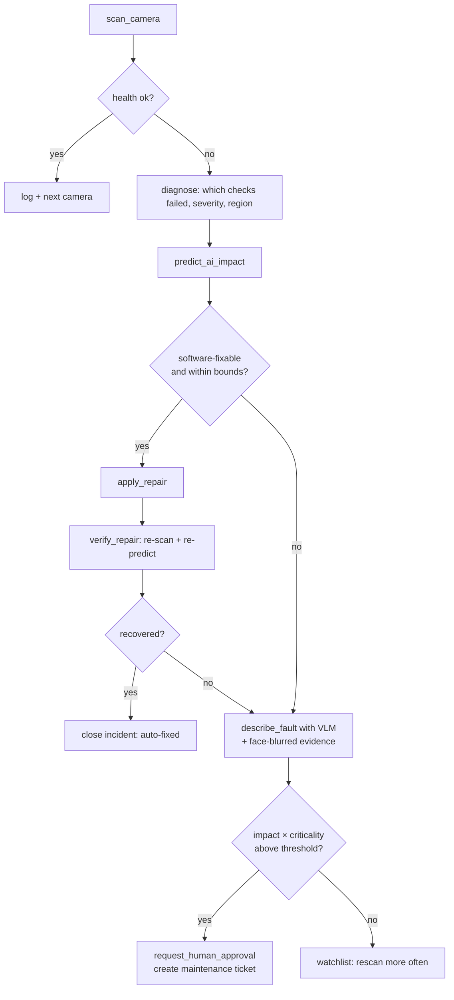

# 02 — Architecture

## 1. System overview

Mermaid source must also be exported to `docs/img/architecture.png` (use `@mermaid-js/mermaid-cli`)
for the report and video. A judge-facing version should label which boxes run **COOL on Arm**.

## 2. Agent perception → decision → action loop

Every arrow is a recorded trace step (docs/04 §5). This is the evidence for the Agentic Vision Award:
OpenCV outputs (scores, homography residuals, impact predictions) change the next tool call.

## 3. Components
| Component | Runs on | Responsibility |
|---|---|---|
| FleetSimulator | local / EC2 | Streams videos as cameras, injects faults, writes ground truth |
| Health worker | Graviton + COOL | Pull job → load frames → 11 checks → HealthReport → store |
| Impact predictor | Graviton + COOL | DNN detector (OpenCV 5 engine) + agreement + regressor |
| MCP tool server | Graviton + COOL | Exposes scan/diagnose/repair/verify/describe tools |
| Agent service | Graviton (or Fargate Arm) | Bedrock LLM agent or policy agent; guard; traces |
| API | Fargate Arm / ASG + ALB | REST for dashboard; approvals |
| Dashboard | S3 + CloudFront | Fleet grid, incidents, traces, benchmarks |

## 4. Data model (identical fields in SQLite and DynamoDB)

**cameras**: `camera_id` (PK), `name`, `site`, `lat`, `lon`, `criticality` (1–5), `stream_uri`,
`reference_version`, `status` (healthy|watch|degraded|failed|repairing), `last_scan_at`.

**health_reports**: `camera_id` (PK), `ts` (SK), `overall_score` 0..1, `checks` (map name →
{score, severity 0–5, evidence}), `heatmap_s3_key`, `predicted_ai_accuracy`, `predicted_drop`,
`worker_instance`, `is_cool` (bool), `scan_ms`.

**incidents**: `incident_id` (PK), `camera_id` (GSI), `opened_at`, `fault_types[]`,
`priority_score`, `state` (open|auto_repairing|repaired|awaiting_approval|dispatched|closed|false_alarm),
`repairs[]` (type, params, before, after, verified), `vlm_description`, `evidence_keys[]`,
`approved_by`, `trace_id`.

**traces**: `trace_id` (PK), `step` (SK), `tool`, `input`, `output_summary`, `decision_reason`,
`latency_ms`, `tokens_in/out` (if LLM), `guard_verdict`.

DynamoDB: on-demand billing, PITR on, TTL on `health_reports` (30 days) and S3 lifecycle on
frames (7 days) / evidence (90 days).

## 5. REST API (FastAPI, OpenAPI auto-generated at `/docs`)
| Method | Path | Purpose |
|---|---|---|
| GET | `/health` | liveness + OpenCV version + `is_cool` |
| GET | `/cameras` | fleet list with latest status |
| GET | `/cameras/{id}` | details, latest report, reference vs. current frame URLs |
| GET | `/cameras/{id}/history?hours=24` | health timeline |
| POST | `/cameras/{id}/scan` | enqueue on-demand scan |
| GET | `/incidents?state=` | incident queue sorted by priority |
| POST | `/incidents/{id}/approve` / `/reject` | human decision (Cognito user recorded) |
| GET | `/traces/{trace_id}` | full agent trace |
| GET | `/bench` | latest COOL benchmark results |
| POST | `/sim/scenario` | (demo only, admin group) start a fault scenario |

Presigned S3 URLs (5-minute expiry) for images. All routes except `/health` require a Cognito JWT.
