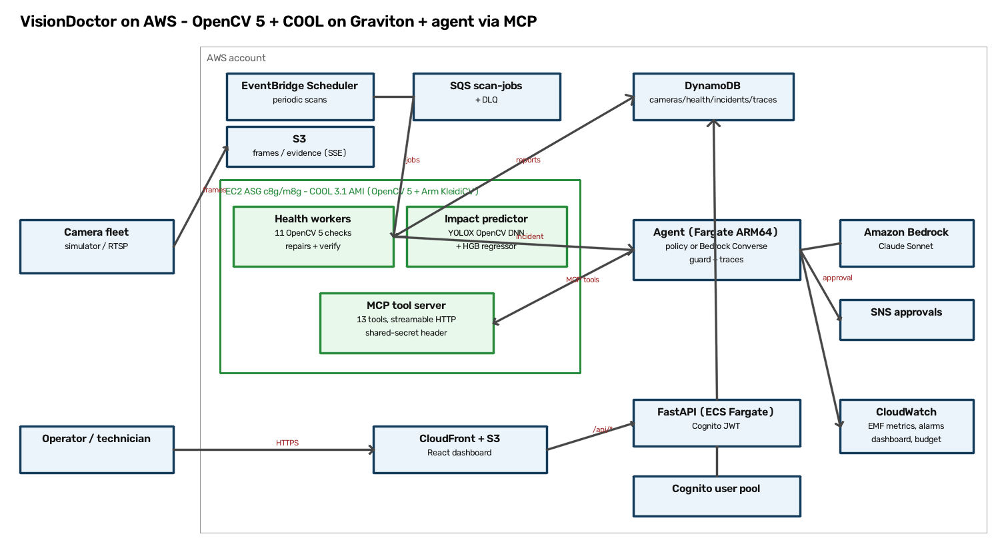
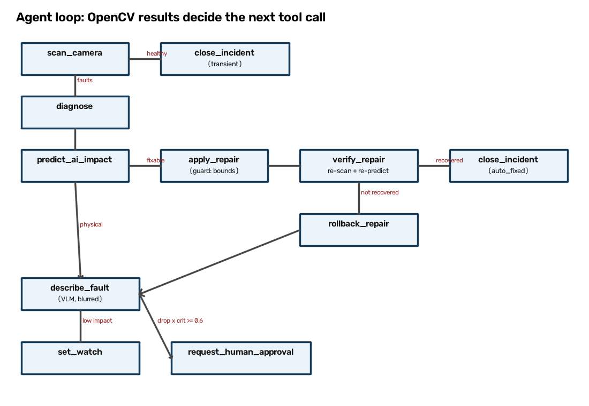

# VisionDoctor — Technical Report

*OpenCV AI Competition 2026 (powered by AWS). Targets: Grand Prize, Agentic Vision Award, Best Use of COOL Award.*
Every number below is copied from a file in `results/final/` (produced by the scripts in `eval/` and `bench/`).

## 1. Summary

Cameras silently degrade — drift, fog, dirt, glare, freezes — and the AI running on them degrades with them.
VisionDoctor watches a camera fleet with **11 OpenCV 5 health checks**, predicts **without labels** how much a
downstream detector's accuracy has dropped, **repairs** software-fixable faults through a bounded correction
profile, **verifies** each repair by re-scanning and re-predicting, and escalates physical faults to a human with
face-blurred evidence. An agent (deterministic policy or Amazon Bedrock Converse) acts only through an **MCP tool
server**, behind a guard, with a full trace. Headline results: fault-detection recall **0.911** at severity ≥ 3 vs
**0.239** for a classic tamper-detector baseline with **0** alarms on clean bursts (E1); verified realignment restores
**92%** of the person-detection AP lost to drift on real MOT17 labels (0.114 → 0.346; E4); the label-free impact
predictor ranks true MOT17 AP drops with Spearman ρ **0.50** (95% CI 0.42–0.58; E3).

## 2. Problem and users

Public audits: Philadelphia (only 32% of sampled police cameras working properly; condensation and blur),
Baltimore CitiWatch (12% of 830 cameras not functional; uptime not tracked), Pittsburgh (45 of 163 not fully
operational). Research: detectors fall to 30–60% of clean performance under corruptions (Michaelis et al. 2019);
real sensor corruptions remain damaging even for high-mAP detectors (Liu et al., IJCV 2024). Users: city and campus
security operations (which cameras actually work), traffic/ANPR teams (accuracy per camera), factory inspection
(calibration drift), maintenance technicians (fewer wasted truck rolls, the right tool on the first visit).

## 3. Related work and novelty

Tamper detection (Saglam 2009, Huang 2014, Sidnev 2018) raises alarms only; self-healing camera networks (Attarha
2026) apply fixed rules to a few faults; Wischow et al. (2021) link blur/noise to detection capability without an
agent. Our contributions: (1) **label-free AI-impact prediction** trained on a self-supervised agreement target;
(2) **verified self-repair** (a repair only counts if re-scan and re-prediction recover, otherwise rollback and
escalate); (3) **root-cause description** for technicians (OpenCV 5 VLM path, rule-based fallback); (4) a
**risk-ranked queue** (predicted drop × criticality).

## 4. Architecture

Health workers, the impact predictor and the MCP server run on **EC2 Graviton with the COOL 3.1 AMI** (OpenCV 5.0 +
Arm KleidiCV, `/opt/cool/venvs/python_3.12`; VisionDoctor is installed without the OpenCV wheel so COOL's `cv2` is
used). The API/agent runs on ECS Fargate ARM64; storage is S3 + DynamoDB; Cognito protects the API; CloudFront serves
the React dashboard. The same code runs fully locally (`VD_BACKEND=local`: SQLite + filesystem).

## 5. OpenCV 5 implementation

| Component | OpenCV 5 functions |
|---|---|
| Reference | `ORB_create` on the per-pixel median background, masked to static regions; per-tile baselines via `Laplacian`, `Sobel`, `Canny`, `calcHist`, `cvtColor` (HSV/Lab), INTER_AREA block means |
| Sharpness | contrast-normalised Laplacian variance / Tenengrad, `dft` high-frequency ratio |
| Drift | `BFMatcher.knnMatch` + ratio test, `findHomography(..., USAC_MAGSAC)`, similarity refit `estimateAffinePartial2D(LMEDS)`, `perspectiveTransform`; tile checks re-run on `warpPerspective`-compensated frames |
| Vibration | `goodFeaturesToTrack` + `calcOpticalFlowPyrLK` + `estimateAffinePartial2D(RANSAC)` |
| Haze | dark channel (`erode` of channel minimum), contrast and saturation relative to luminance |
| Glare | `inRange` HSV mask, `morphologyEx`, `connectedComponentsWithStats` |
| Occlusion | `boxFilter` local-contrast collapse vs reference with an affine-residual test, `createBackgroundSubtractorMOG2` static objects, `findContours` (TRUCO) → boxes |
| Smudge | tile-wise normalised sharpness loss, persistent over 3 scans on static tiles |
| Colour cast | Lab chroma shift not explained by saturation scaling |
| Noise | temporal σ from burst differences; Immerkaer `filter2D` σ as evidence |
| Freeze | `absdiff` + 64×36 thumbnail hash, duration tracked |
| Repairs | `warpPerspective` (realign), `LUT` gain/gamma + `createCLAHE`, dark-channel dehaze with a `boxFilter` guided filter, `multiply` white balance, `fastNlMeansDenoisingColored` |
| Impact | YOLOX-S via `dnn.readNetFromONNX(..., engine=cv2.dnn.ENGINE_NEW)` (new graph engine), `dnn.NMSBoxesBatched` |
| Privacy | `FaceDetectorYN` (YuNet) → mosaic + `GaussianBlur`, re-detect until no face remains; fails closed |
| VLM | PaliGemma2 through `dnn.readNetFromONNX` + `dnn.Tokenizer` (follows `samples/dnn/vlm_inference.py`) |

Startup asserts OpenCV ≥ 5 (`cv_runtime.py`). Every relevant op is timed (`vd.op_ms`) and exported as CloudWatch EMF.

## 6. AWS deployment

CDK v2 (Python), seven stacks with cdk-nag (AwsSolutions): `VdNetwork` (2-AZ VPC, private subnets, S3/DynamoDB
gateway and SQS/Bedrock/SSM/Secrets/Logs interface endpoints), `VdData` (S3 SSE + Block Public Access, lifecycle 7 d
frames / 90 d evidence, DynamoDB on-demand + PITR + TTL, SQS + DLQ), `VdAuth` (Cognito groups operator/technician/
admin, SSM model parameter), `VdCoolCompute` (COOL AMI launch templates, IMDSv2, encrypted EBS, SSM-only access, ASG
scaled on queue depth, internal ALB for MCP with a shared-secret header), `VdApp` (Fargate ARM64, least-privilege task
role, SNS approvals), `VdWeb` (CloudFront + OAC, `/api/*` to the ALB), `VdObservability` (dashboard, alarms on DLQ,
scan p95, guard blocks, Bedrock throttles, ASG at max; $50 budget). `VdBench` launches COOL / stock-Graviton / x86
benchmark instances that self-terminate. The stacks are synthesised in this submission; deployment requires the COOL
Marketplace subscription and was not performed (see `docs/DEVIATIONS.md`).

## 7. Agentic workflow

13 MCP tools (SDK v2 `MCPServer`; stdio and streamable HTTP): `list_unhealthy_cameras`, `scan_camera`, `diagnose`,
`predict_ai_impact`, `get_reference_comparison`, `apply_repair`, `verify_repair`, `rollback_repair`, `describe_fault`,
`request_human_approval`, `create_maintenance_ticket`, `set_watch`, `close_incident`. The **guard** checks every call:
tool allowlist, camera/incident scope, repair bounds (rotation ≤ 10°, displacement ≤ 12% of the diagonal, inlier ratio
≥ 0.5, gain/gamma/ω/h ranges), "fault must be present at severity ≥ 2 in the latest scan", ≤ 2 repair attempts,
step/token budgets, and tickets only after an approved human approval. A blocked call returns
`{"error": "blocked_by_guard"}` so the agent re-plans. Seven golden-trace tests cover drift → auto-fixed, haze →
auto-fixed, smudge/occlusion/freeze → approval, transient glare → closed, and 25° drift → guard block → escalation.

Example trace (`results/final/example_trace_drift.json`): scan (drift sev 4, rotation and displacement) → diagnose →
predict impact → `apply_repair(realign)` → `verify_repair` (drift sev 4 → 0, predicted accuracy recovers) →
`close_incident(auto_fixed)`. Bedrock: the Converse loop maps MCP `list_tools` to `toolSpec`s and routes each `toolUse`
through the same guard; in this account Anthropic models returned `AccessDeniedException (INVALID_PAYMENT_INSTRUMENT)`,
so the runner fell back to the policy agent (recorded in the trace).

## 8. Evaluation

Sources: MOT17-02/04/09 sequence videos with person labels, OpenCV `vtest.avi`; faults from our OpenCV injectors.
95% bootstrap CIs. Seeds fixed.

**E1 — detection** (`results/final/e1_detection.json`, 1,216 scans). Recall at severity ≥ 3: **0.911** vs 0.239 for a
reference-free tamper baseline; clean-burst alarm rate 0.0 (baseline 0.0). Per fault (recall at severity 1/3/5):
haze 1.0/1.0/1.0, defocus 1.0/1.0/1.0, freeze 1.0/1.0/1.0, colour cast 0.19/1.0/1.0, exposure 0.19/1.0/1.0, occlusion
0.0/1.0/1.0, vibration 0.44/1.0/1.0, smudge 0.38/0.81/0.88, drift 0.0/0.75/0.75 (MOT17-02 abstains: too few static
keypoints), glare 0.94/1.0/0.31 (severity-5 flares are attributed to over-exposure), spider web 0.31 (VLM hint only).
Noise has low precision (0.25): motion faults raise temporal noise.

**E2 — false alarms** (`results/final/e2_false_alarms.json`, 328 clean scans). Scans are 0.2 s apart because the
clips are short, so consecutive scans see nearly the same content and hysteresis/persistence decorrelate little.
Extrapolated false incidents per camera-day with 2-scan hysteresis: 26.3 (no hysteresis: 259). vtest and MOT17-09
produce **0**; the crowded MOT17-04 (32.5) and MOT17-02 (74.5) drive the rate — our main failure case. Day+night
replay: luminance buckets 57.1 vs single reference 74.6 (ablation; without hysteresis 360 vs 790).

**E3 — label-free impact** (`results/final/e3_impact.json`, 2,656 samples, leave-one-video-out). Predicted vs actual
agreement: Spearman ρ **0.533** (95% CI 0.498–0.565), MAE 0.140 (per held-out video ρ 0.48–0.70). Against **true** MOT17
person AP@0.5 drop (461 fault × severity groups, out-of-fold): ρ **0.504** (0.418–0.583). This is below our 0.7 target;
tuning (shallower trees, lower learning rate, random forest) reached at most 0.557. Most important features: detection
count ratio vs baseline, drift displacement, occluded fraction, drift inlier ratio, normalised sharpness.

**E4 — repairs** (`results/final/e4_repair.json`, MOT17 labels). Realign: verified 100% of attempts, max residual
rotation 0.0°, person AP 0.114 → **0.346** (clean 0.338): **0.92** of lost accuracy recovered (95% CI 0.87–0.96).
Colour cast: verified 100%; haze: 78%; exposure: 82%; noise: 62% (fails at severity ≥ 3). For exposure, haze, colour
and noise the detector lost little AP (clean 0.338 vs degraded 0.31–0.35), so "accuracy recovered" is not meaningful
there (CIs span zero) — YOLOX is robust to these photometric faults at our severities; geometric faults hurt most.

**E5 — agent** — see `results/final/e5_agent_policy.json` and §8 addendum below.

## 9. Limitations and failure cases

Crowded scenes (MOT17-02/04) raise smudge/occlusion false alarms and starve drift of static keypoints; short
reference windows (8 s instead of ≥ 10 min) amplify this. Legitimate scene changes look like drift/occlusion; PTZ
cameras need a `ptz=true` flag. Severity-5 glare is confused with over-exposure. Spider webs are only flagged in
the dark. Impact prediction is moderate (ρ ≈ 0.5) and trained on simulated faults from four scenes. Photometric
repairs pass verification but do not raise detector AP measurably. The VLM was not run (12 GB RAM); captions are
rule-based. COOL performance was not measured (no Graviton deployment); no speedup is claimed.

## 10. Responsible use

No face recognition; faces mosaicked on every stored/shown evidence image (fails closed without the model); frames
expire after 7 days, evidence after 90; physical actions require human approval; every agent decision is traced with
the OpenCV numbers behind it; Cognito roles; least-privilege IAM. VisionDoctor improves reliability of existing
cameras; it adds no new identification capability.

## 11. Reproducibility

`make setup models data test` (Python 3.12, pinned `requirements.lock` with hashes; `web/package-lock.json`;
CDK 2.274.0). `make eval-impact`, `make calibrate eval`, `make bench`. Seeds = 7. Data licences:
`docs/DATA_LICENSES.md`. Deviations: `docs/DEVIATIONS.md`.

## 12. References

See `docs/09_REFERENCES.md`.
